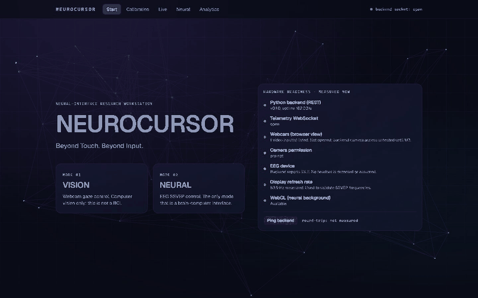
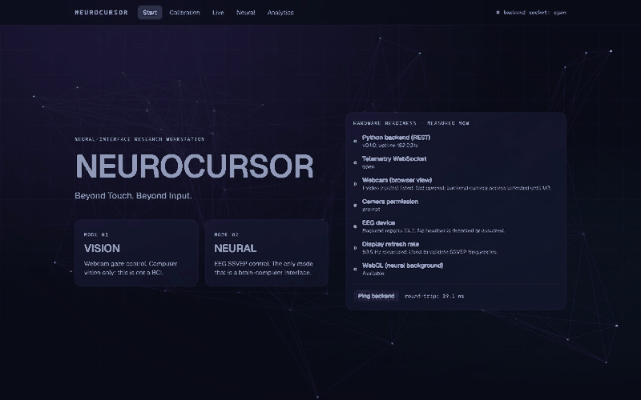
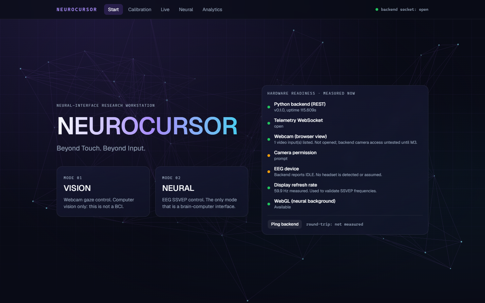
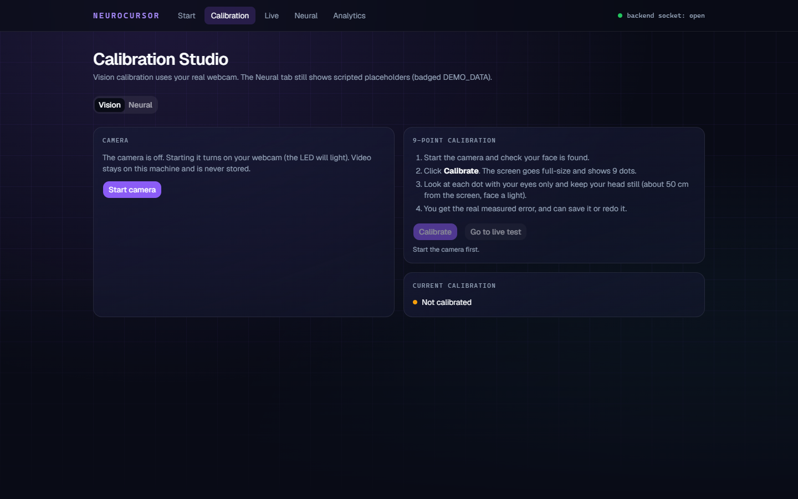
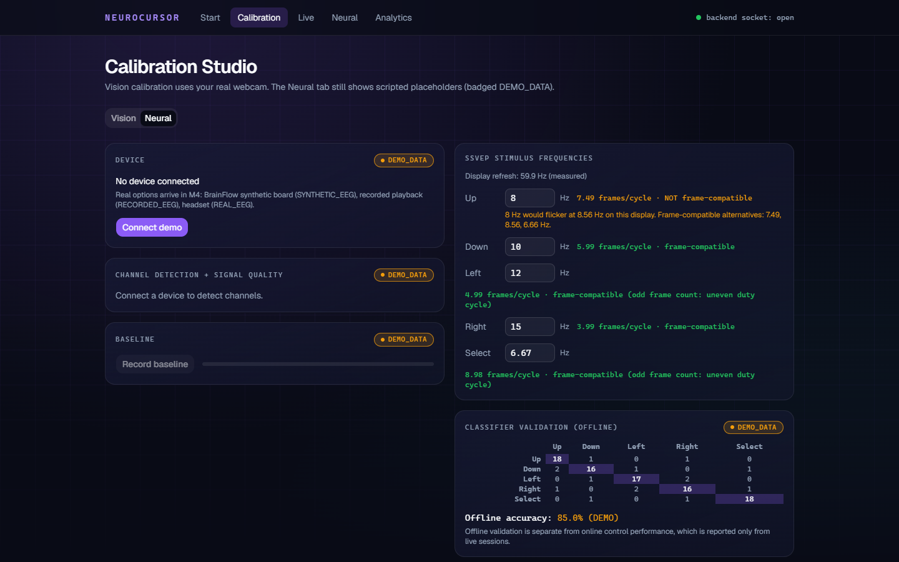
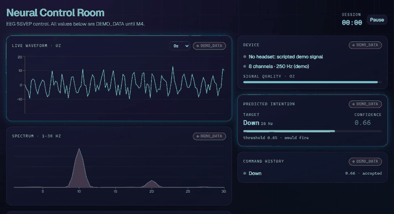
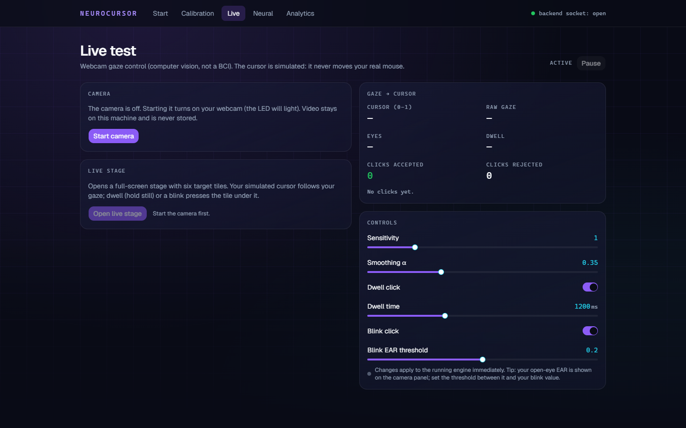
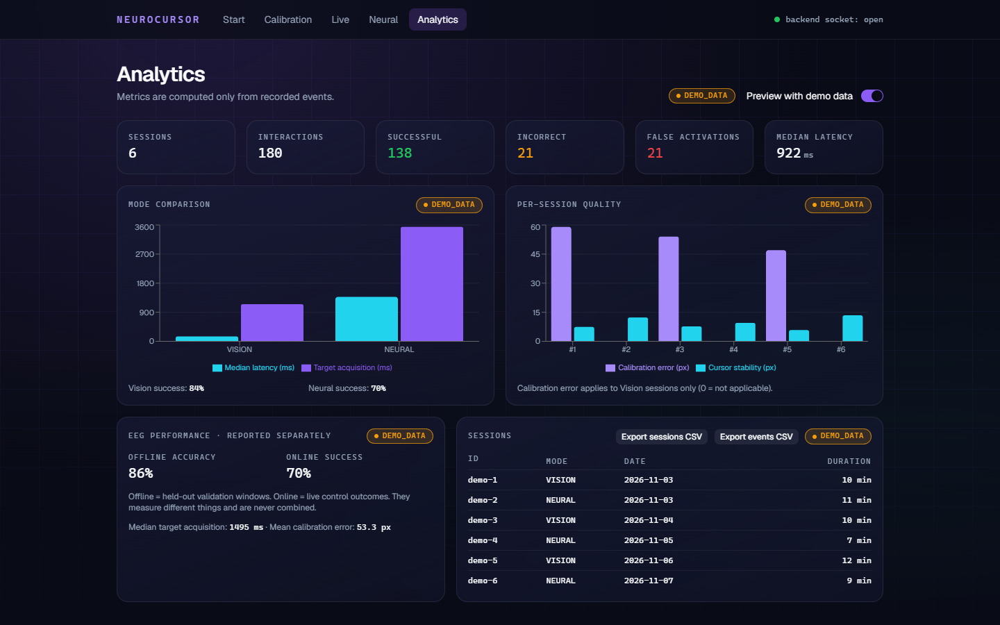
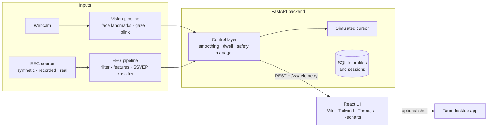

<div align="center">

# 🧠 NEUROCURSOR

### *Beyond Touch. Beyond Input.*

A neural-interface research workstation with two independent input modes feeding one simulated cursor engine.




</div>

---

## ✨ What is it?

NeuroCursor lets you drive an on-screen cursor in two completely different ways, and compare them side by side.

| | 👁️ **VISION** | 🧠 **NEURAL** |
|---|---|---|
| **Input** | Webcam gaze tracking | EEG, steady-state visual evoked potentials (SSVEP) |
| **Technology** | Computer vision (MediaPipe face landmarks) | Signal processing + classifier (BrainFlow, SciPy, scikit-learn) |
| **Is it a BCI?** | **No.** It is computer vision only. | **Yes.** The only mode that is a brain-computer interface. |
| **Click** | Dwell (hold still) or a deliberate blink | Confidence-thresholded command from the classifier |
| **Hardware needed** | A webcam | None for now: runs on a synthetic EEG source |

> **Honesty first.** Every number on screen carries a data-source badge (`REAL_WEBCAM`, `REAL_EEG`, `SYNTHETIC_EEG`, `RECORDED_EEG` or `DEMO_DATA`), so you always know whether you are looking at a real measurement or a scripted placeholder. The cursor is **always simulated**: nothing in this project can move your real mouse.

## 🎬 Tour

<div align="center">

</div>

## 🖼️ Screens

### Start: measured hardware readiness
Backend, WebSocket, webcam, EEG device and display refresh rate are checked live, not assumed.



### Calibration Studio
Vision uses a 9-point gaze calibration and reports the real held-out error. Neural validates that your SSVEP frequencies are compatible with your display's measured refresh rate.

| Vision calibration | Neural calibration |
|---|---|
|  |  |

### Neural Control Room
Live EEG waveform, spectrum, predicted intention with confidence against a firing threshold, and a command history.

<div align="center">

</div>

> The Neural screen currently shows scripted `DEMO_DATA` (badged on every panel). The EEG engine itself is implemented and tested in the backend; wiring it into this screen is still to do.

### Live test (Vision)
Tune sensitivity, smoothing, dwell time and the blink threshold while the engine is running.



### Analytics
Metrics are computed only from recorded events. Offline classifier accuracy and online control success are reported separately and never combined. Sessions and events export to CSV.



> The Vision live stage needs a real webcam, so it is not shown here.

## 🏗️ Architecture



## 🚀 Quick start

### Prerequisites

| Tool | Used for | Version tested |
|---|---|---|
| Python 3.12 (3.11 preferred; 3.13 not yet verified against MediaPipe/BrainFlow) | backend | 3.12.8 |
| Node + npm | frontend | Node 26.13.0, npm 11.20.0 |
| Rust + MSVC Build Tools + WebView2 | Tauri desktop shell | **not installed on the dev machine; Tauri is untested** |

### Setup (Windows PowerShell, from the repo root)

```powershell
py -3.12 -m venv .venv
.\.venv\Scripts\python.exe -m pip install -r backend\requirements.txt
cd frontend; npm install; cd ..

# One-time: MediaPipe Face Landmarker model (about 4 MB, from Google's model bucket; git-ignored).
# The app never downloads anything at runtime.
New-Item -ItemType Directory -Force backend\vision\models | Out-Null
Invoke-WebRequest "https://storage.googleapis.com/mediapipe-models/face_landmarker/face_landmarker/float16/1/face_landmarker.task" -OutFile backend\vision\models\face_landmarker.task
```

`mediapipe` requires the contrib build of OpenCV (`opencv-contrib-python`). Do not also install `opencv-python`: both provide `cv2` and clobber each other.

### Run

| Layer | Command | Result |
|---|---|---|
| Backend | `.\.venv\Scripts\python.exe -m uvicorn backend.main:app --host 127.0.0.1 --port 8000` | REST + `/ws/telemetry` on :8000 |
| Frontend | `cd frontend; npm run dev` | http://localhost:5173 (proxies `/api` and `/ws` to :8000) |
| Desktop | `cd frontend; npm run tauri dev` | **Requires Rust + MSVC; untested** |

Start the backend first (its first start takes a few seconds while MediaPipe loads), then the frontend, then open http://localhost:5173. Screens can be opened directly by URL: `#/welcome`, `#/calibration`, `#/vision`, `#/neural`, `#/analytics`.

## 👁️ Using the Vision mode

1. **Calibration** → **Start camera** (turns on your webcam; the first start takes up to ~20 s).
2. **Calibrate**: the screen goes full-size and shows 9 dots. Look at each with your eyes only, head still. You get the **real measured held-out error** and a verdict; **Save profile** (or **Recalibrate**).
3. **Live** → **Open live stage**: a full-screen stage with six tiles. A **simulated** cursor follows your gaze; **hold still** (dwell ring) or **blink once** to press the tile under it. Esc exits.

The same engine is available from the command line:

```powershell
.\.venv\Scripts\python.exe -m backend.vision.cli probe       # opens the webcam ~3 s: measured fps, detection rate, EAR, timings. Saves nothing.
.\.venv\Scripts\python.exe -m backend.vision.cli calibrate   # full-screen 9-point calibration, prints held-out error, saves a profile
.\.venv\Scripts\python.exe -m backend.vision.cli live        # gaze -> SimulatedCursor with dwell/blink clicks (Esc quits)
```

Through the API: `POST /api/vision/start`, then `POST /api/vision/calibrate` with `step` = `start`, `capture` (per `point_index`), `finish`, `save`; `GET /api/vision/preview.mjpg` for the preview; telemetry arrives on `/ws/telemetry`. Starting vision turns the camera on (the camera LED will light); stopping releases it. Video stays on your machine and is never stored.

## 🧠 Using the Neural mode (no headset needed)

No headset is needed or assumed. Each source is labelled in code and in every telemetry event:

| `kind` for `POST /api/eeg/connect` | Label | What it is |
|---|---|---|
| `injected_synthetic` (default) | `SYNTHETIC_EEG` | Our simulator with a settable ground-truth SSVEP target (WebSocket `{"type":"set_synthetic_target","hz":12}`) |
| `brainflow_synthetic` | `SYNTHETIC_EEG` | BrainFlow's own board: fixed tones at 5k Hz per channel, no SSVEP ground truth |
| `playback` (`file`) | `RECORDED_EEG` | BrainFlow playback of a BrainFlow-format file |
| `brainflow_real` (`board_id`, `serial_port`) | `REAL_EEG` | A real headset. **Never tested here.** |

Flow: `connect` → `start` (optional body: targets, window, thresholds) → telemetry (`eeg_update`, `classification_update`, `interaction_event`) → `stop` → `disconnect`. Starting EEG makes NEURAL the active control mode.

```powershell
.\.venv\Scripts\python.exe -m backend.eeg.evaluation   # measures offline accuracy and online control on the simulator (about 1 min)
```

> ⚠️ **Photosensitivity warning.** The SSVEP stimulus targets flicker at 6 to 15 Hz. Flicker is off until you press **Start flicker**; stop immediately if you feel unwell. People with photosensitive epilepsy should not use it.

## 🧪 Test

```powershell
.\.venv\Scripts\python.exe -m pytest -q     # backend (repo root)
cd frontend; npm test                       # vitest + React Testing Library
cd frontend; npm run typecheck; npm run lint; npm run build
```

## 📁 Project layout

```
backend/    FastAPI app: api/ vision/ eeg/ control/ db/
frontend/   Vite + React + TypeScript (strict); src-tauri/ holds the Tauri scaffold
tests/      pytest suites (frontend tests sit beside the code as *.test.ts[x])
docs/       PROGRESS.md (carry-forward context) and assets/ (README images)
```

## 📡 Contracts

- **Data-source labels** (`backend/api/schemas.py`, mirrored in `frontend/src/lib/telemetry.ts`): `REAL_WEBCAM`, `REAL_EEG`, `SYNTHETIC_EEG`, `RECORDED_EEG`, `DEMO_DATA`.
- **Telemetry envelope:** `{type, timestamp (ms since epoch), source, payload}`. Camera frames are rejected by a validator and never travel over this socket.
- **WebSocket client messages:** `{"type":"ping","id":N}` is answered with a `system_log` event whose payload is `{message:"pong", ping_id:N, server_timestamp}`.
- **`GET /api/system/status`** reports each subsystem honestly (`NOT_IMPLEMENTED` until built).

## 🗺️ Status

Simulation only, by choice: the milestone that would add Rust/Tauri desktop packaging and OS-level cursor control was skipped.

| Area | State |
|---|---|
| Vision pipeline (gaze, blink, calibration, dwell/blink clicks) | Implemented, wired into the UI |
| EEG engine (SSVEP pipeline on synthetic/recorded EEG) | Implemented in the backend; UI still shows `DEMO_DATA` |
| Real EEG headsets | Code path exists, **never tested** |
| Tauri desktop shell | Scaffold only, **untested** |

See [docs/PROGRESS.md](docs/PROGRESS.md) for what works, what is untested and what remains.

## 📄 License

Released under the [MIT License](LICENSE).
